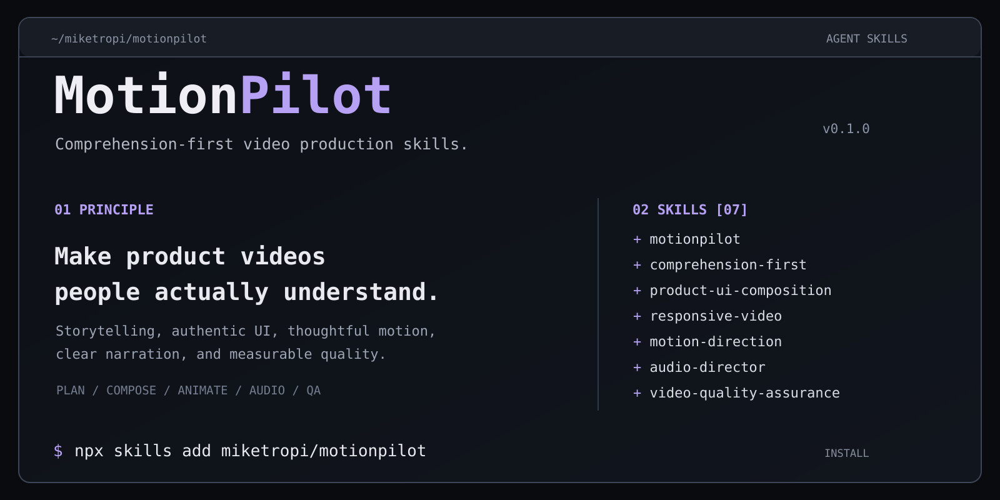

# MotionPilot



**Comprehension-first video production skills for AI agents.** Turn authentic screen recordings and screenshots of web apps, SaaS dashboards, WordPress plugins, and other digital products into understandable, polished videos.

MotionPilot is a set of **Agent Skills**: production rules, shot-planning frameworks, motion patterns, audio direction, responsive composition, and quality gates. It is **not** a video renderer or a replacement for Remotion, FFmpeg, After Effects, or your editing tool.

> **If viewers cannot explain what happened after watching, the edit is not finished — no matter how impressive the animation looks.**

## Install

Requirements: an agent compatible with [Agent Skills](https://agentskills.io/specification), and **Node.js 22.20+** for the current [skills CLI](https://github.com/vercel-labs/skills).

```bash
# Interactively choose skills and your coding agent
npx skills add miketropi/motionpilot

# See the skills available in this repository
npx skills add miketropi/motionpilot --list

# Install the full collection non-interactively
npx skills add miketropi/motionpilot --all

# Install one or more focused skills
npx skills add miketropi/motionpilot --skill motionpilot
npx skills add miketropi/motionpilot --skill audio-director --skill motion-direction

# Install globally (select desired skills/agents when prompted)
npx skills add miketropi/motionpilot -g

# Example: target a supported agent
npx skills add miketropi/motionpilot --skill motionpilot -a claude-code -y
```

Run the commands **in the project directory** where you use your agent, unless installing globally. For a pinned version, use `npx skills add miketropi/motionpilot@<tag-or-commit>`.

To check for updates after installation: `npx skills check` and `npx skills update`.

## Skills

| Skill | When to activate |
| --- | --- |
| [`motionpilot`](skills/motionpilot/SKILL.md) | Direct a complete video project from source analysis through delivery |
| [`comprehension-first`](skills/comprehension-first/SKILL.md) | Design tutorial learning outcomes, narrative beats and viewer takeaways |
| [`product-ui-composition`](skills/product-ui-composition/SKILL.md) | Preserve real product UI, choose safe framing, apply selective detail magnification |
| [`responsive-video`](skills/responsive-video/SKILL.md) | Create independently composed 16:9, 9:16, 4:5 or 1:1 versions |
| [`motion-direction`](skills/motion-direction/SKILL.md) | Plan restrained typography reveals, transitions and camera motion |
| [`audio-director`](skills/audio-director/SKILL.md) | Produce aligned narration, background music, semantic SFX and audio mixing |
| [`video-quality-assurance`](skills/video-quality-assurance/SKILL.md) | Review readability, comprehension, temporal continuity, audio and export quality |

**Suggested default:** install all seven skills for full production work. Install just one for a focused task. The `motionpilot` orchestrator knows when to coordinate the others, but does not require hidden tool capabilities.

## Typical workflow

```text
Source assets (screenshots / screen recordings / branding)
   ↓  Inspect actual UI, labels, privacy and source quality
Audience & outcome  →  "What should the viewer understand?"
   ↓  Learning-driven storyboard (one concept → one demonstration → one takeaway)
Aspect-specific shot planning (16:9, 9:16, 4:5, ...)
   ↓  Accurate UI composition + selective closeups
Motion (heading → description → readable hold → real UI → result)
   ↓  Narration + music + semantic sound cues (when requested)
Review samples, transitions, actual playback, audio and exports
   ↓  Deliver video + editable project + manifests + QA report
```

**The full interface should not be persistently zoomed, cropped, or panned to fill a vertical frame.** Establish context, show a readable focus, and selectively use a source-linked magnified detail when it genuinely improves understanding.

## Example prompts

**Guided WordPress tutorial**

> Use MotionPilot to edit these screen recordings into a beginner-friendly AlonePro WordPress tutorial. Explain template import, menu setup, donation testing and receipt verification. Keep original UI intact and readable. Create a 16:9 version with subtle text motion and narration. Include a scene plan and QA report.

**Mobile-first feature introduction**

> Use MotionPilot to make a 9:16 feature walkthrough from my web app screenshots. Introduce each chapter with a short explanation, show what the UI does, and end each feature with one takeaway. Only zoom when necessary; don't crop away context. Produce a mobile QA report.

**Audio-only polish**

> Use the audio-director skill to add English narration, gentle background music and sparse SFX to this approved product demo. Preserve the existing visual edit, provide separate WAV stems and check narration synchronization.

## Project outputs

For substantive jobs, aim for `storyboard.md`, an aspect-specific `shot-manifest.json`, editable project files, final video file(s), audio stems where applicable, and `QA_REPORT.md`. For a machine-readable starting point, see [the example shot manifest](examples/alonepro-walkthrough.json) and [production workflow](docs/WORKFLOW.md).

## Boundaries

- **Product truth:** never invent UI states, interactions, metrics or reward logic.
- **Privacy:** mask donor/customer information in footage and audio; verify masks remain attached during crops.
- **Honest quality reporting:** decoding success is not proof of viewer comprehension. Label untested outcomes honestly.
- **Copyright / licensing:** check rights for music, fonts, voice models and footage before publishing; no rights are granted to third-party assets by these skills.
- **Tools:** install and configure any rendering, TTS and audio tools separately. No API credentials or paid services are bundled.
- **Cross-format:** the skills support both horizontal and vertical output; each ratio needs its own shot plan and QA.

## Repository layout

```text
motionpilot/
├── skills/
│   ├── motionpilot/SKILL.md
│   ├── comprehension-first/SKILL.md
│   ├── product-ui-composition/SKILL.md
│   ├── responsive-video/SKILL.md
│   ├── motion-direction/SKILL.md
│   ├── audio-director/SKILL.md
│   └── video-quality-assurance/SKILL.md
├── docs/
│   ├── WORKFLOW.md
│   └── REFERENCES.md
├── examples/
│   └── alonepro-walkthrough.json
├── AGENTS.md
└── README.md
```

## References

MotionPilot adapts design principles from the [Agent Skills specification](https://agentskills.io/specification), [skills CLI](https://github.com/vercel-labs/skills), [Remotion documentation](https://www.remotion.dev/docs/), and audio skill patterns from [ElevenLabs](https://github.com/elevenlabs/skills). See [references](docs/REFERENCES.md). These projects are **not** dependencies or endorsements.

## Contributing

Issues and pull requests are welcome. Keep instructions tool-agnostic where possible, make claims testable, and include cross-format and comprehension implications with every motion pattern change. The repository has no license file yet; choose a license before assuming redistribution permissions.
